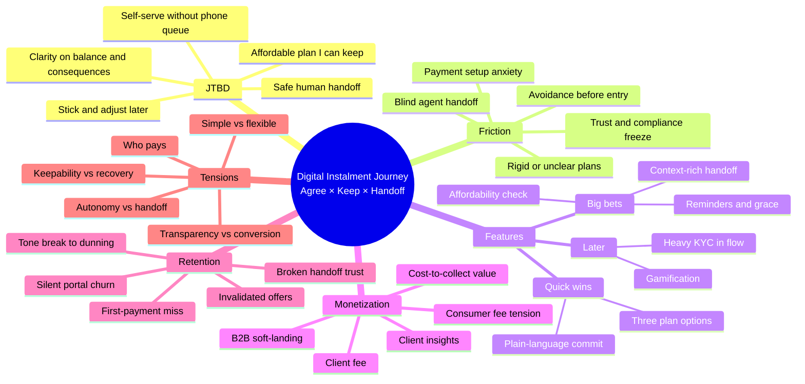

# Discovery mindmap · Digital Instalment Journey

**Case:** BU Collection — *A Fair Way Forward*  
**Lead:** A digital instalment journey that helps consumers agree to a plan they can keep, with a clear handoff to an agent.  
**Primary user:** A consumer with an outstanding balance (persona: **Mara**) who wants to agree digitally to an instalment plan they can keep — and hand off to an agent (**Daniel**) with full context when stuck.

| North star signals | Meaning |
|---|---|
| Keep plan | Outcome north star (agree × keep, not submit alone) |
| Clear handoff | When digital stalls |
| No surprise | Trust constraint |

**Discovery focus:** Not “more features,” but which job most moves Agree × Keep × Resolve — and where policy/risk constrains product freedom.

**Debate first**
- Keepability vs. recovery speed
- Autonomy vs. early agent exit
- Consumer fee vs. client / cost-to-collect value

---

## 1 · Core user jobs-to-be-done

Job format: When… I want… So I can… — condensed here to outcome.

| Job | Why now | Success looks like |
|---|---|---|
| Find a plan I can actually afford to keep | Protect cashflow without escalation | First instalment feels doable; remaining term is understandable |
| Get clarity fast on balance, deadlines, and consequences | Reduce uncertainty and avoidance | One screen shows amount, dates, and what happens if I miss a payment |
| Complete it myself — without phone-queue friction | Control and speed | Plan confirmed in a few steps; confirmation visible immediately |
| Hand off safely to a human when I feel stuck | Complex cases / fear of choosing wrong | Handoff carries context; agent does not re-ask the whole story |
| Stick to the plan afterward and adjust if life gets tight | Avoid repeat default shame | Reminders, pause/reschedule paths are clear — without a new spiral |

**Discovery question:** Which job dominates entry (clarity vs. affordability vs. autonomy) — and which job decides whether the plan is kept?

**VP check:** The value proposition must break **Mara’s silence** (avoidance / wait / do nothing) as the primary obstacle, and fix **Daniel’s pain** (blind restart) as the fail-safe when digital stalls.

---

## 2 · Key friction in existing behavior

Today’s behavior: letter / portal / hotline / chat — often avoidance until escalation, then fast but fragile agreements.

| Moment | Friction | Measurable signal |
|---|---|---|
| Before entry | Letters/portals feel threatening; link trust is low | High drop-off before auth / first page |
| Plan selection | Rigid instalments / minimum too high / total cost unclear | Abandons on slider/options; hotline calls “can this be cheaper?” |
| Trust & compliance | Fine print, SEPA, legal text → freeze | Long dwell time without submit; support “what am I signing?” |
| Payment setup | Wrong method, IBAN anxiety, fear of first direct debit | Error codes; later mandate cancellations |
| After agreement | No overview; reminders arrive too late or too aggressive | Missed first payment; re-contact with zero context |
| Agent handoff today | Consumer retells the story; agent cannot see the digital attempt | Double work; inconsistent promises digital vs. voice |

**Tension flagged:** Agent handoff without digital context creates systematic double work — both a friction point and a strategic product gap.

**Moment of misery:** Waiting / doing nothing instead of acting — **systemic**, not an edge case (mass non-entry + mid-journey freeze).

---

## 3 · Feature ideas · Effort vs. Impact

### Quick wins (high impact · low effort)
- Three clear plan options instead of free-form complexity — choice architecture; fast to validate
- Plain-language summary before commit — trust + completion

### Big bets (high impact · medium/high effort)
- Soft affordability check + recommended instalment — core promise: a plan they can keep
- Context-rich agent handoff (attempt, choice, blocker) — differentiation digital ↔ human
- Payment reminders + grace path before default — retention of the agreement

### Fill-ins (medium impact · often policy-dependent)
- Self-serve reschedule / pause request — policy/risk dependent; good discovery spike
- Chatbot before agent (FAQ / status) — only if intent scope is tightly bounded

### Avoid / later (low impact or wrong tone/risk)
- Gamified “debt-free” progress tracker — tone risk under financial stress
- Video KYC / ID upload inside the flow — friction↑ unless truly mandatory

| Idea | Impact | Effort | Quadrant |
|---|---|---|---|
| Soft affordability check + recommended instalment | High | Medium | Big bet |
| Three clear plan options instead of free-form complexity | High | Low | Quick win |
| Context-rich agent handoff (attempt, choice, blocker) | High | Medium | Big bet |
| Plain-language summary before commit | High | Low | Quick win |
| Payment reminders + grace path before default | High | Medium | Big bet |
| Self-serve reschedule / pause request | Medium | High | Fill-in |
| Chatbot before agent (FAQ / status) | Medium | Medium | Fill-in |
| Gamified “debt-free” progress tracker | Low | Medium | Avoid / later |
| Video KYC / ID upload inside the flow | Low | High | Avoid / later |

*Ranking is a sprint hypothesis — calibrate with completion, first-payment kept, handoff resolve time, complaint rate.*

---

## 4 · Monetization paths & tradeoffs

| Path | Upside | Tradeoff | Debate? |
|---|---|---|---|
| Merchant/client fee per successful plan | Aligned with conversion; scalable | Pressure to maximize plans vs. keepability | Yes — strategic |
| Consumer convenience fee | Direct revenue; willingness-to-pay measurable | Trust break; ethically/optically risky in distress | Yes — strategic |
| Reduced collection cost (internal value) | AHT↓, digital share↑, recovery↑ — business case without extra fee | Harder to sell as “product revenue”; needs attribution | Low |
| Premium soft-landing (longer term / pause) as B2B upsell | Differentiates the client offering | Credit risk & portfolio economics; policy gatekeeping | Yes — strategic |
| Insights for clients (plan-fit, segment performance) | Secondary value stream; sticky B2B | Privacy, data quality, sales complexity | Low |

**Core tradeoff:** Any consumer fee competes with the care job “a plan I can keep.” An internal cost-to-collect case is often the most honest primary case; consumer fees only with clear perceived value and ethical guardrails.

---

## 5 · Retention risks & responses

“Retention” here = plan kept + channel relationship not burned (they return digitally at the next squeeze).

| Risk | Cause | Response |
|---|---|---|
| First-payment miss after digital agreement | Optimistic agreement / wrong instalment size | Affordability soft-gate; D+1/D-2 reminders; easy method change |
| Silent churn: plan exists, portal never reopened | No ongoing utility beyond paying | Status push with remaining balance; one clear next action |
| Broken handoff → user avoids digital next time | “Online didn’t help; agent knew nothing” | Shared case context; agent script aligned with digital offer |
| Aggressive dunning after a soft digital promise | Tone break: digital care → hard collection | Journey-aware treatment; grace before escalate |
| Policy changes invalidate promised plans | Trust collapse; complaints / chargebacks | Versioned offers; immutable confirmation artifact |

**Early-warning metric:** Don’t track plan-agree rate alone — first-payment success and digital retry after handoff decide whether the product is sticky or one-shot harmful.

---

## Strategic tensions · debate deliberately

Don’t “feature these away” — resolve them in discovery as decision records with a measurement criterion.

1. **Keepability vs. recovery speed**  
   Lower instalments raise completion and first-payment success — but stretch cash recovery and portfolio risk. Who owns the objective function: consumer outcome or recovered € / time?

2. **Autonomy vs. agent handoff**  
   Handoff too early kills digital share; too late frustrates vulnerable users. Do we need confidence/complexity gates, or always a visible exit?

3. **Monetize the consumer vs. the client**  
   Consumer fees fund the product clearly — and collide with a care positioning. Client fees align better, but demand a proven cost-to-collect lever.

4. **Transparency vs. conversion**  
   Full costs/consequences before submit reduce surprise and complaints, but can raise abandon. Discovery must measure Completion × Kept Plan, not submit rate alone.

5. **One-size plans vs. segmented flexibility**  
   Simple three-option UI scales operations; real affordability needs flexibility and risk rules. When is complexity value — and when is it just cost?

---

## Sprint recommendation

### In scope for discovery
Validate JTBD priority · affordability hypothesis · handoff context · success metric Agree×Keep (not submit alone) · unblock Mara’s silence (uncertainty → inaction)

### Explicitly out of scope
Gamification · heavy ID flows · consumer-fee launch — only after a trust/keep baseline

---

## Mermaid overview

---

*Companion canvas: `instalment-journey-discovery-mindmap.canvas.tsx` (Cursor canvases folder). Practice evidence for the case is fictional — do not present as Riverty facts.*
