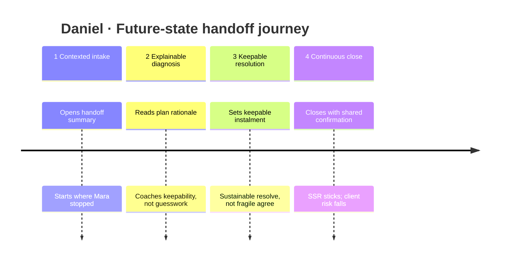

# Future-State Journey · Persona Daniel

**Case:** BU Collection — Digital Instalment Journey  
**Persona:** Daniel (collection agent)  
**Strategy:** Riverty Collection is moving from “digital volume of agreements” to sustainable digital resolution: keepable self-serve plans, with a context-rich agent handoff when the consumer cannot finish alone.  
**Value proposition (Module 1):** For consumers like Mara who cannot clear a balance in one go, Riverty Collection offers a digital instalment journey that helps them agree to a plan they can actually keep — and hands them to an agent with full context when they cannot finish alone — so recovery stays responsible, self-service rises for real, and avoidable agent work falls. Promise: sustainable digital resolution — not digital volume of agreements.  
**Workaround replaced:** Blind voice restart (re-ask typed details; failed plan = “just a number”).

---

## Visual timeline

---

## 4 stages

### 1. Contexted intake

| Field | Content |
|---|---|
| **Stage name** | Contexted intake |
| **User action** | Opens inbound call with digital handoff summary visible |
| **Internal state** | Oriented — already knows Mara’s online attempt |
| **Pain point addressed** | Blind restart / re-asking data already typed (N-08) |

- **Action → Benefit:** Opens handoff summary → Starts where Mara stopped

### 2. Explainable diagnosis

| Field | Content |
|---|---|
| **Stage name** | Explainable diagnosis |
| **User action** | Reviews consumer inputs and plan-offer rationale |
| **Internal state** | Clear why that plan was offered |
| **Pain point addressed** | Failed plan shows “just a number” (N-09) |

- **Action → Benefit:** Reads plan rationale → Coaches keepability, not guesswork

### 3. Keepable resolution

| Field | Content |
|---|---|
| **Stage name** | Keepable resolution |
| **User action** | Confirms or adjusts an affordable instalment plan |
| **Internal state** | Aligned — consequences shared and explainable (N-12) |
| **Pain point addressed** | Fragile verbal rebuilds and digital↔voice drift |

- **Action → Benefit:** Sets keepable instalment → Sustainable resolve, not fragile agree

### 4. Continuous close

| Field | Content |
|---|---|
| **Stage name** | Continuous close |
| **User action** | Shares the same confirmation Mara would see digitally |
| **Internal state** | Done — case auditable without double work |
| **Pain point addressed** | Avoidable AHT and broken-plan / complaint noise (N-10) |

- **Action → Benefit:** Closes with shared confirmation → SSR sticks; client risk falls

---

## Competitive advantages vs. manual voice-restart hack

1. **Context continuity** — continues Mara’s attempt instead of rediscovering from zero.
2. **Explainable offers** — plan rationale replaces opaque “just a number” recovery.
3. **Keepable outcomes** — resolution quality (agree × keep) beats agreement volume and burns less cost.

---

_Practice evidence referenced (N-08, N-09, N-10, N-12) is sample/illustrative — not Riverty research._
